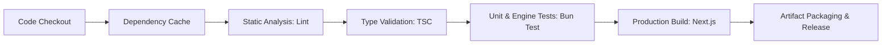

# Continuous Integration & Delivery (CI/CD) Workflow

This document sets the automated quality verification, test gating, and deployment procedures for EzGame.

## Core Rules

1. Language: English only.
2. Icon Policy: Zero decorative emojis.
3. Package Management: Bun runtime (`bun`, `bun.lock`). Never generate `package-lock.json` or `yarn.lock`.
4. Quality Gates: Every build pipeline must pass typechecking, linting, unit tests, and production build without errors.

## CI Pipeline Stages

## Detailed Execution Commands

1. Dependency Installation:
   `bun install --frozen-lockfile`
2. Static Analysis:
   `bun run lint`
3. Type Checking:
   `bunx tsc --noEmit`
4. Automated Game Logic Tests:
   `bun test`
5. Production Build:
   `bun run build`

## Pipeline Failure Criteria

Any commit or pull request will be immediately blocked if:
- TypeScript compilation fails with any error.
- ESLint reports unused imports or syntax violations.
- Any unit test file (`*.test.ts`) fails assertion.
- Build output reveals missing client/server boundaries (`"use client"` directive missing on interactive components).
