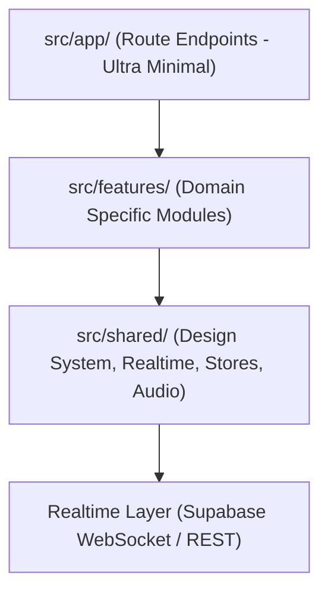
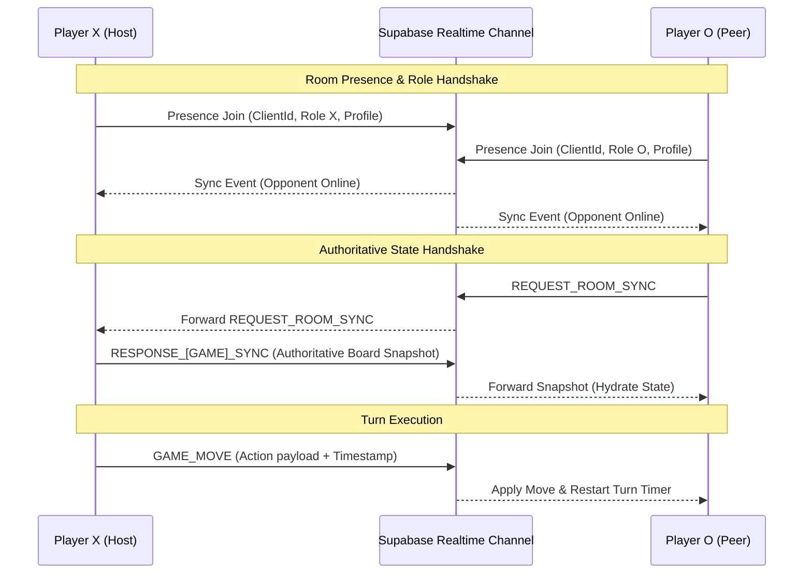

# System Architecture Specification

## 1. Architectural Overview

EzGame is a real-time, zero-authentication multiplayer casual gaming web platform. The platform operates on a decentralized room paradigm where users create match rooms, share invite links, and engage in turn-based or physics-based matches instantly in their browsers.

### Technology Stack

- Runtime and Package Manager: Bun
- Framework: Next.js (App Router, React 19)
- Language: TypeScript (Strict mode enabled, no raw strings for defined domains)
- State Management: Zustand (with local persistence for player identity)
- Styling: Tailwind CSS, CSS Custom Properties
- Real-Time Messaging: Supabase Broadcast and Presence channels (WebSocket)
- Physics Engine: Matter.js (Billiards simulation)
- Rule Engines: chess.js (Chess), custom deterministic rule evaluators (Caro, Xiangqi, Animal Chess)
- Internationalization: next-intl (English, Vietnamese, Japanese)

---

## 2. Layered Architecture & Module Separation

EzGame enforces Feature-Sliced Design (FSD) to isolate game domains and maintain low coupling:

### Module Boundary Rules

1. `src/features/[game]/` owns all UI components, game-specific hooks, domain types, and pure rule checkers for that specific game.
2. Cross-module imports between different game modules are strictly forbidden (e.g. `src/features/chess` must not import from `src/features/caro`).
3. Shared utilities, global layout wrappers, and design system components reside exclusively in `src/shared/`.
4. Page files in `src/app/` must be single-line re-exports of Page components from `src/features/[game]/pages/`.

---

## 3. Realtime Synchronization Architecture

Match synchronization relies on a dual-protocol model:

### Protocol Resilience Strategy

1. Debounced Presence Disconnect: A 4-second grace period prevents layout flickering during minor network jitter or page reloads (F5).
2. Authoritative Re-sync: Reconnecting peers broadcast `REQUEST_ROOM_SYNC`. The active peer replies with an immutable snapshot, ensuring game continuity.
3. Turn Timer Fallback: If a client experiences a timeout, the active client broadcasts `GAME_TIMEOUT_PASS_TURN` to maintain synchronized progression.
