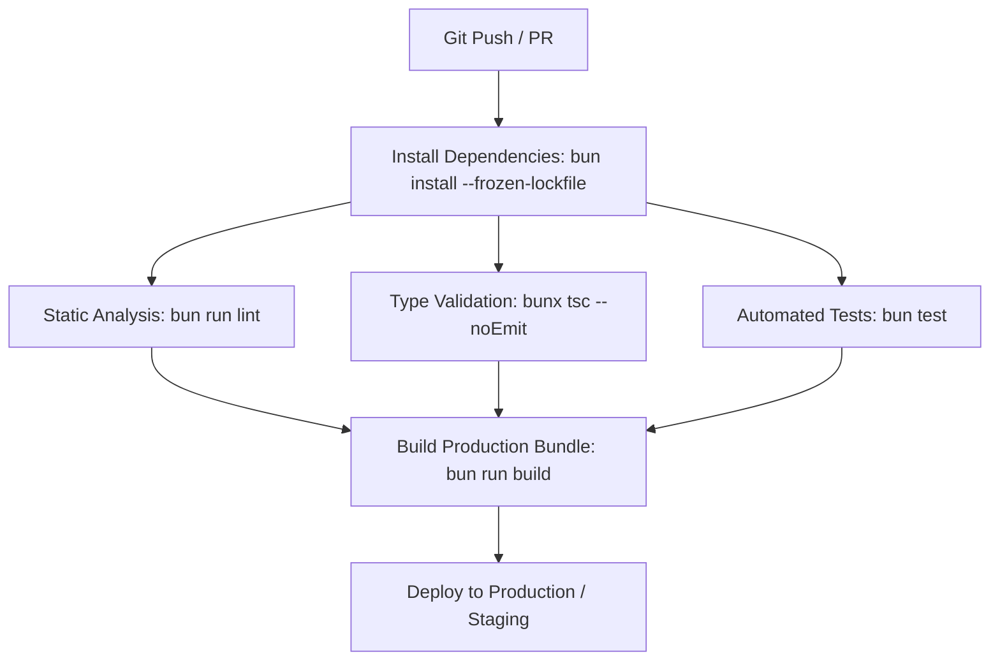

# Continuous Integration & Delivery (CI/CD)

## 1. Automation Pipeline Architecture

Every pull request and push to `main` executes a multi-stage validation pipeline on GitHub Actions:



---

## 2. GitHub Actions Workflow Configuration (`.github/workflows/ci.yml`)

```yaml
name: CI Quality Gate

on:
  push:
    branches: [main]
  pull_request:
    branches: [main]

jobs:
  validate:
    runs-on: ubuntu-latest
    steps:
      - name: Checkout Repository
        uses: actions/checkout@v4

      - name: Setup Bun Runtime
        uses: oven-sh/setup-bun@v2
        with:
          bun-version: latest

      - name: Install Dependencies
        run: bun install --frozen-lockfile

      - name: Lint Codebase
        run: bun run lint

      - name: Validate TypeScript Types
        run: bunx tsc --noEmit

      - name: Run Game Logic Unit Tests
        run: bun test

      - name: Production Next.js Build
        run: bun run build
```

---

## 3. Strict Merge Gates

A Pull Request cannot be merged if:
1. `bunx tsc --noEmit` reports any error.
2. ESLint reports unused imports or formatting violations.
3. Any unit test under `src/**/__tests__` or `src/**/*.test.ts` fails.
4. Build artifact generation fails due to missing client/server directives.
