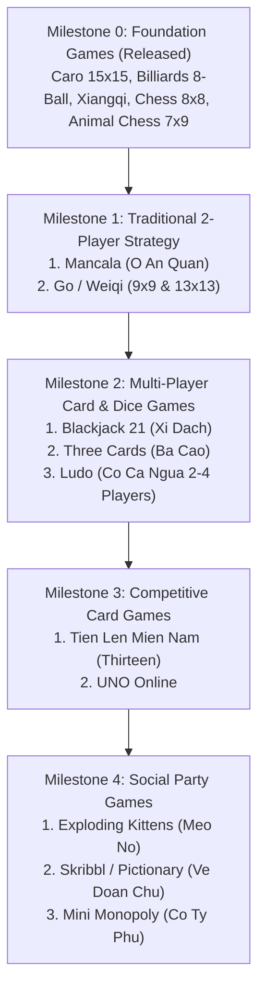

# Product Roadmap & Game Release Strategy

## 1. Roadmap Principles

- Modular Expansion: Each game is implemented within an isolated feature slice (`src/features/[game]/`) to ensure zero regression on existing games.
- Standardized UX: Every game must integrate with `RoomHeader`, `GameBoard`, `GameScoreboard`, `PlayerAvatar`, and the Portal-based `ResultDialog`.
- Zero-Emoji Documentation: All roadmap specs, tickets, and code reviews maintain strict plain-text formatting.

---

## 2. Multi-Phase Delivery Plan

---

## 3. Milestone Breakdown & Resource Requirements

### Milestone 1: Traditional 2-Player Strategy

#### 1.1 Mancala (O An Quan)
- Scope: 10 regular pits, 2 mandarin semi-circles. Clockwise and counter-clockwise pebble sowing mechanics.
- Resource Requirements:
  - Pebble drop sound effect (wooden click series).
  - Sowing queue animation controller.
  - Localization entries in `vi.json`, `en.json`, `ja.json`.
- Estimated Complexity: Medium.

#### 1.2 Go / Weiqi (9x9 & 13x13)
- Scope: Intersection grid board, liberty calculation algorithm (BFS flood fill), Ko rule tracking, territory scoring on double pass.
- Resource Requirements:
  - Black and white stone assets.
  - Placement sound effect.
- Estimated Complexity: High.

---

### Milestone 2: Multi-Player Card & Dice Games

#### 2.1 Standard 52-Card Library
- Prerequisite shared component: `src/shared/components/cards/playing-card.tsx` rendering SVG vector faces for all 52 cards + card back.
- Card shuffle and deal sound effects.

#### 2.2 Blackjack 21 & Three Cards
- Turn-based hit, stand, double down logic.
- Instant scoring calculation and dealer showdown.

#### 2.3 Ludo (Co Ca Ngua)
- 4-player support, 3D dice roll simulation, track path navigation, capturing mechanics, and home stretch climbing.
